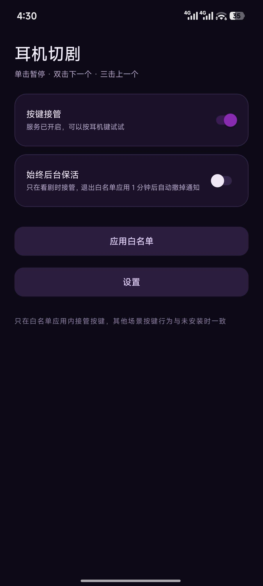

# PodSkip · 耳机切剧

用耳机线控/蓝牙耳机的按键控制短剧 App，不用掏手机：**单击暂停/播放，双击下一个视频，三击上一个视频**。

An Android accessibility service that maps wired/Bluetooth headset key presses to gestures on short-drama apps.

> 仅支持 Android 12+（minSdk 31），在 Xiaomi 14 / HyperOS（Android 16）上实机验证。

[](https://github.com/wmm387/PodSkip/releases)
[](https://github.com/wmm387/PodSkip/issues)
[](LICENSE)

<p align="center">
  
</p>

## 特性

- **单击 / 双击 / 三击**：单键耳机（只发 `KEYCODE_HEADSETHOOK`）也能区分，判定窗口可调（200–600 ms，默认 400 ms）。
- **横屏自动适配**：多数播放器横屏后单击只亮进度条、双击才暂停，因此横屏时把单击映射成屏幕双击。
- **白名单**：只在你指定的 App 里接管按键，其他地方耳机键照常工作。默认不带任何应用，引导里可选番茄小说 / 红果短剧 / 红果漫剧。
- **佩戴检测**：耳机断开时自动暂停，重新连上后自动恢复（带恢复时限，防隔夜外放）。
- **长按防误触**：吞掉长按产生的重复/松开事件，避免唤起语音助手。
- **常驻保活通知**：开启期间通知栏显示一条常驻提示，并实时显示「正在接管：某某 App」，方便确认当前状态。
- **零联网**：没有 `INTERNET` 权限，不读取屏幕内容。

## 工作原理

```
耳机按键 → AccessibilityService.onKeyEvent（flagRequestFilterKeyEvents）
        → MultiTap 状态机（单击/双击/三击）
        → dispatchGesture 注入点击 / 上滑 / 下滑
        → 播放器自己的手势识别逻辑接管（暂停、下一个、上一个）
```

关键点：判定后 `return true` 把按键吞掉，否则播放器自己也会响应，造成跳过两条。注入坐标使用 `WindowManager.currentWindowMetrics.bounds`，而非 `displayMetrics`（后者在部分机型上不含导航栏，会让滑动落点偏移）。

## 构建

需要 JDK 17、Android SDK Platform 35。不需要 Android Studio。

```bash
git clone https://github.com/wmm387/PodSkip.git
cd podskip

# 指到本机 SDK（首次）
echo "sdk.dir=$HOME/Library/Android/sdk" > local.properties   # macOS
# echo "sdk.dir=$HOME/Android/Sdk" > local.properties         # Linux

./gradlew assembleDebug
# 产物：app/build/outputs/apk/debug/app-debug.apk
```

`settings.gradle.kts` 里优先使用阿里云镜像，国内网络下首次拉依赖会快很多；海外可直接删掉那几行 `maven(...)` 走 google()/mavenCentral()。

安装：

```bash
adb install -r app/build/outputs/apk/debug/app-debug.apk
```

### Release 签名包

释放版开启了 R8 混淆 + 资源压缩，体积从 11 MB 降到 2.4 MB。

签名信息从仓库根目录的 `keystore.properties` 读取，该文件不入库（`*.jks`、`keystore.properties` 都在 `.gitignore` 里）。首次构建自己的 release 包：

```bash
# 1. 生成自己的 keystore（有效期 30 年）
keytool -genkeypair -v -keystore keystore/podskip-release.jks -storetype JKS \
  -alias podskip -keyalg RSA -keysize 2048 -validity 10950

# 2. 按 keystore.properties.example 填一份 keystore.properties
cp keystore.properties.example keystore.properties
#    然后改里面的 storePassword / keyPassword

# 3. 构建
./gradlew assembleRelease
# 产物：app/build/outputs/apk/release/app-release.apk
```

没有 `keystore.properties` 时 release 也能编译，只是产出未签名的 APK，不会报错。

> 换签名会导致无法覆盖安装：release 和 debug 签名不同，两个包不能互相覆盖，先 `adb uninstall com.zero.podskip` 再装另一个。

### 版本号

版本号只在根目录 `gradle.properties` 里改，构建脚本和主页底部显示都读这两个值：

```properties
VERSION_CODE=1        # 每次发版 +1，否则系统视为同一个包，装不上
VERSION_NAME=0.1.0    # 展示用，主页底部显示 v0.1.0 (1)
```

## 使用

1. 打开 App，按引导走完：开无障碍 → 允许通知 → 按键测试 → 手势参数 → 选应用。
2. 打开短剧 App 播放，按耳机键。
3. 手感不对时进「设置」调判定窗口，或进「高级设置」切按键模式。

换耳机后按键行为可能不同，用「设置 → 耳机按键测试」，按几下，页面会识别耳机类型并给出建议判定窗口，可一键采用。

## 遇到问题（按键没反应等）

**反馈入口：[GitHub Issues](https://github.com/wmm387/PodSkip/issues/new/choose)**，请附上下面导出的诊断日志。

不用教用户开 adb：

1. 打开「设置 → 导出诊断日志」，点一下会弹出分享面板；
2. 选微信 / 邮件 / 任意文件管理器把 txt 存下来；
3. 在 Issues 里新建一条，把文件拖进去（或直接粘贴内容）。

文件里包含：机型、系统/ROM 版本、无障碍与通知权限状态、后台运行豁免状态、白名单和各项参数，以及带毫秒时间戳的事件流（前台应用切换、按键到达、击数判定、手势注入结果）。另有 3 秒一次的主线程心跳，进程被系统冻结时会写一条 `W/beat: 主线程 xxx ms 没跑起来`——这类"按键要拉一下通知栏才生效"的问题，日志里能直接看到冻结时长。

同目录下保留最近 5 份导出文件，其余自动清理。日志只存在本机，App 没有联网权限，不会自动上传任何东西。

## 已知限制

- **单击有 0.4 秒左右的延迟**：单键耳机三种击法都发同一个键码，必须等判定窗口结束才能确定是单击还是双击的开始。硬件层面的限制，无法消除。
- **单击是注入屏幕点击**：播放器必须响应点击才能暂停；个别播放器把单击完全吃掉时，可关掉「单击接管」让它自己处理（此时双击/三击失效）。
- **佩戴检测不是真的入耳检测**：Android 没有公开的入耳状态 API，实现依赖「音频输出设备断开」。有线拔出、蓝牙断开、摘下即断连的耳机能触发；**只摘一只、蓝牙仍连着的 TWS 检测不到**。
- **系统可能解绑无障碍服务，或冻结后台进程**：MIUI/HyperOS 的 `GreezeManager` 会冻结后台进程，冻结期间耳机按键会被扣在系统队列里，表现为"按了没反应，拉一下通知栏才好"。需要授予「后台运行不受限制」（引导页第 2 步，或系统设置里把省电策略设为「无限制」）。服务被解绑后按键不会有任何反应。
- **重装 APK 后**需要把无障碍开关关一次再打开，服务才会重新绑定。

## 权限

| 权限 | 用途 |
| --- | --- |
| `BIND_ACCESSIBILITY_SERVICE` | 过滤耳机按键事件、注入手势（核心功能） |
| `FOREGROUND_SERVICE` / `FOREGROUND_SERVICE_SPECIAL_USE` | 在看剧期间保持服务存活 |
| `POST_NOTIFICATIONS` | 显示前台服务通知（Android 13+ 需运行时授予） |
| `REQUEST_IGNORE_BATTERY_OPTIMIZATIONS` | 申请「后台运行不受限制」，避免进程被系统冻结 |
| `VIBRATE` | 预留，当前版本未使用 |

没有网络权限，不收集、不上传任何数据。无障碍服务不读取窗口内容和文字，只用 `typeWindowStateChanged` 判断前台应用包名（用于白名单）。

## 项目结构

```
app/src/main/java/com/zero/podskip/
├── MainActivity.kt                 主页：开关、状态、入口
├── Settings.kt                     SharedPreferences 配置
├── core/
│   ├── SwipeKeyService.kt          无障碍服务：按键 → 手势
│   ├── MultiTap.kt                 单击/双击/三击状态机
│   ├── WearDetector.kt             音频输出设备监听（佩戴检测）
│   ├── KeyProbe.kt                 按键记录 + 判定窗口建议
│   ├── Logs.kt                     运行日志 + 心跳 + 诊断日志导出
│   └── AppUsageTracker.kt          最近前台应用
└── ui/
    ├── OnboardingActivity.kt       5 步引导
    ├── GestureSettingsActivity.kt  设置：滑动参数
    ├── AdvancedSettingsActivity.kt 高级设置：按键行为、佩戴检测
    ├── KeyTestActivity.kt          耳机按键测试
    └── AppListActivity.kt          白名单管理
```

## 路线图

- [ ] 手势参数实时预览（改完立刻注入一次让用户看效果）
- [ ] 更多机型的自启动/省电引导
- [ ] 截图与使用演示

## 许可

MIT，见 [LICENSE](LICENSE)。

## 免责声明

本项目与任何短剧应用无关，不修改、不破解目标应用，只是把耳机按键翻译成普通的触摸手势。请自行确认在所在地区使用按键映射类工具的合规性。
